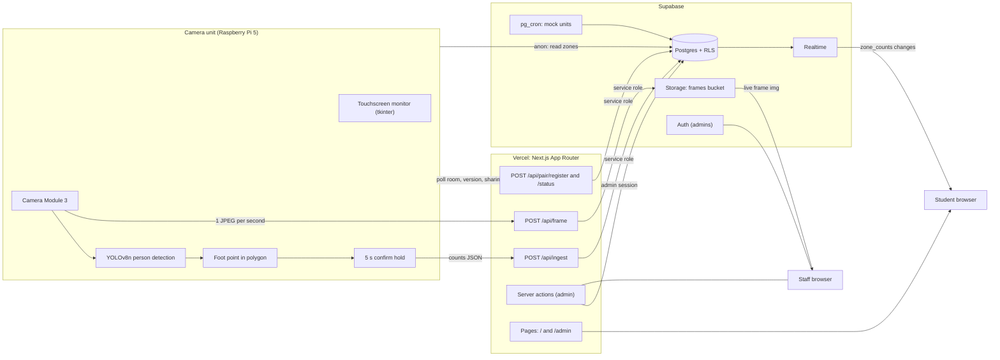
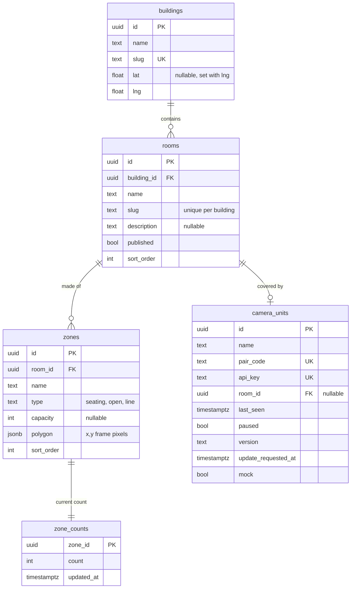
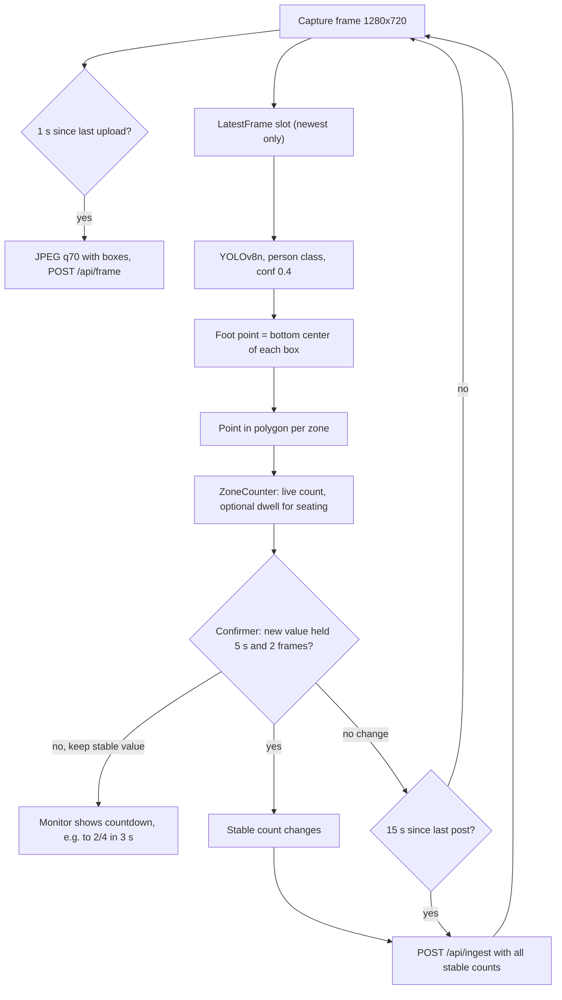
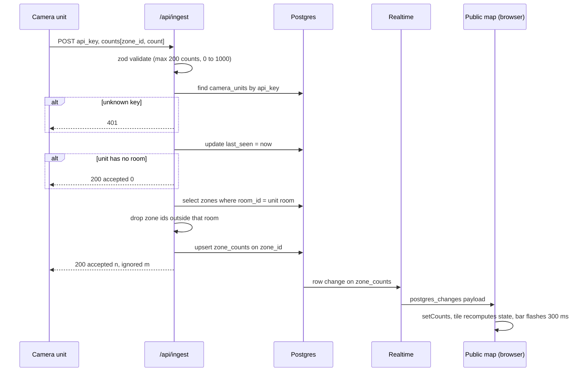
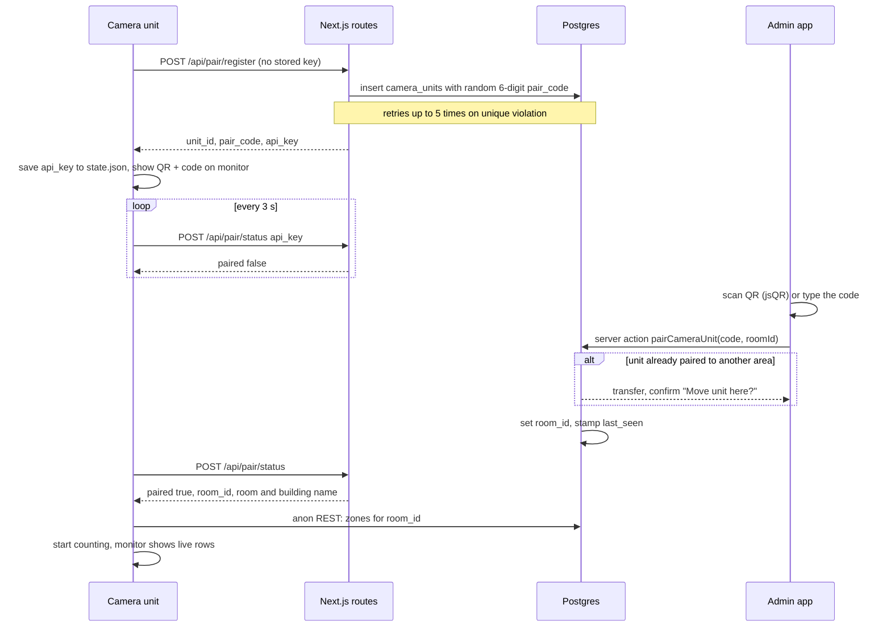
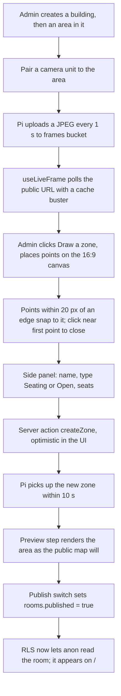

# Spot

Repo working name: free-space-detector. Live at https://csun-spot.vercel.app.

Camera units count people inside hand-drawn zones. The counts, never the video, go to a Next.js app on Vercel and a Supabase database. Students open a public map and see which tables are free right now.

See `CLAUDE.md` for the project brief and `docs/DESIGN.md` for the UI spec. The camera unit has its own guide in `camera-unit/README.md`.

## Contents

- [What Spot is](#what-spot-is)
- [Architecture](#architecture)
- [Stack](#stack)
- [Repo layout](#repo-layout)
- [Data model and RLS](#data-model-and-rls)
- [Counting loop on the camera unit](#counting-loop-on-the-camera-unit)
- [From a post to a tile flip](#from-a-post-to-a-tile-flip)
- [Pairing a camera unit](#pairing-a-camera-unit)
- [Zone setup and publish](#zone-setup-and-publish)
- [Tile, area and building states](#tile-area-and-building-states)
- [Remote updates, pause and live frame](#remote-updates-pause-and-live-frame)
- [Timing](#timing)
- [Security](#security)
- [Routes](#routes)
- [Environment](#environment)
- [Setup](#setup)

## What Spot is

Staff mount a camera unit high in a room corner, pair it, and draw zones over the live frame: one polygon per table, couch or open corner. From then on the unit counts people in each zone and posts the numbers. Students check the public map before walking somewhere. No login for students; staff sign in to the admin app.

| Term | Meaning |
| --- | --- |
| camera unit | Raspberry Pi 5 + Camera Module 3 in a case, with a small touchscreen monitor. The physical thing in the room. |
| building | A named group of areas ("University Library", "Sierra Hall"). Has a slug and an optional lat/lng for the campus map. |
| area | A space one camera unit covers, made of zones. Shown as `{building}, {area}`. Stored in the `rooms` table; code says `Room`, `room_id`. |
| zone | A polygon in frame pixels. Type `seating` (has a capacity) or `open`. `line` is deprecated. |
| admin app | `/admin`. Auth-gated. Buildings, areas, pairing, zone drawing, publishing. |
| public map | `/`. Anonymous. Campus map, search, building directory, live zone tiles. |

## Architecture

There is no separate backend server and no Edge Functions. The camera unit talks to four Next.js route handlers. Those routes hold the Supabase service role key and are the only writers of counts and heartbeats. Browsers read Supabase directly with the anon key, gated by RLS, and get count changes over Realtime.



The Pi reads its zones straight from Supabase REST with the anon key; everything it writes goes through the Next.js routes.

## Stack

| Layer | Technology | Notes |
| --- | --- | --- |
| Web framework | Next.js 16 App Router, React 19, TypeScript | Server components for first render, client hooks for live data, server actions for admin writes. Deployed on Vercel. |
| Styling | Tailwind 4, shadcn/ui on Radix | Restyled only through tokens in `src/app/globals.css`: tweakcn paper palette, cobalt primary, Spot's `state-*`, `band-*`, `building-*` tokens. |
| Type | DM Sans, JetBrains Mono | Mono only for counts and pair codes. Loaded with `next/font/google`. |
| Validation | zod 4 | Request bodies on every API route and server action input. |
| Database | Supabase Postgres | Project `vituloqfqfrjdlblkuis`, us-east-2. Migrations mirrored in `supabase/migrations/`, applied through the Supabase MCP. |
| Live updates | Supabase Realtime | `postgres_changes` on `zone_counts`, plus a 15 s poll as a safety net. |
| Auth | Supabase Auth via `@supabase/ssr` | Admins only. Accounts created by hand. `src/proxy.ts` gates `/admin`. |
| File storage | Supabase Storage | Public `frames` bucket, one JPEG per camera unit, overwritten in place. |
| Scheduling | pg_cron | Every 30 s, ticks mock camera units. |
| Maps | Google Maps via `@vis.gl/react-google-maps` | Campus map and the building pin picker. Not rendered without a key. |
| QR scanning | jsQR | Admin pair form reads the 6-digit code off the unit's screen. |
| Camera unit | Python 3, Picamera2, Ultralytics YOLOv8n, OpenCV, Pillow, tkinter | Person class only. Runs as a systemd user service. Also runs on a laptop with `--webcam` or `--fake`. |

## Repo layout

```
free-space-detector/
  src/
    app/
      page.tsx                     public map (/)
      areas/[building]/[area]/     retired, redirects to /?q={building}
      admin/(dashboard)/           overview: Buildings and Camera units tabs
      admin/(dashboard)/areas/[id] setup page: step rail, zone canvas, preview
      admin/login/                 staff sign in
      admin/actions.ts             server actions: buildings, areas, zones, pairing
      api/ingest/route.ts          camera unit counts + heartbeat
      api/frame/route.ts           camera unit live JPEG
      api/pair/register/route.ts   new unit gets a pair code + api_key
      api/pair/status/route.ts     unit polls for its room, update requests
    components/public-map/         ZoneTile, RoomRow, campus map, live map
    components/admin/              StepRail, QR scanner, group sections
    hooks/                         use-live-snapshot, use-live-frame, use-clock
    lib/occupancy.ts               tile state rules (mirrored in Python)
    lib/public-data.ts             loadPublicSnapshot()
    lib/supabase/                  browser, server, public, admin clients
    proxy.ts                       session refresh + /admin gate
  camera-unit/
    main.py                        entry: pairing, capture + detect threads
    detector.py                    Picamera2 / webcam capture, YOLO, foot points
    zones.py                       zone fetch, point-in-polygon, ZoneCounter, Confirmer
    api.py                         HTTP calls to the four routes
    monitor.py  overlay.py         touchscreen UI, camera popup overlay
    status.py                      shared state, tile rules
    updater.py                     git pull --ff-only, pip if needed, restart
  supabase/migrations/             schema, RLS, buckets, cron
  supabase/seed/csun_campus.sql    CSUN buildings, areas, zones, mock units
  docs/DESIGN.md                   UI spec: tokens, components, every screen
```

## Data model and RLS



| Table | anon (public map, Pi) | authenticated (admins) | service role (API routes) |
| --- | --- | --- | --- |
| buildings | Read all | Full CRUD | Bypasses RLS |
| rooms | Read where `published = true` | Full CRUD | Bypasses RLS |
| zones | Read all (the Pi and the setup preview need draft zones) | Full CRUD | Bypasses RLS |
| zone_counts | Read all | Read all, no writes | Only writer, via `/api/ingest` |
| camera_units | Column grant: `id, name, room_id, last_seen, paused` only | Full CRUD | Writes `last_seen`, `version`, `paused` |

Any signed-in user is an admin; the admin app is the only place that signs in. `api_key` and `pair_code` never reach the anon role because of the column grant. `rooms.kind` is a legacy column; new UI ignores it.

## Counting loop on the camera unit

Two threads. The capture thread runs at the camera's rate, hands the newest frame to the detection thread, draws the monitor popup and uploads one JPEG a second. The detection thread runs YOLO on the newest frame it can keep up with (2 to 4 fps on the Pi 5 CPU) and does everything that touches counts.



- **Foot point only.** Box overlap is never checked. A camera looking down from a corner sees heads lean across zone edges while feet stay where the person is.
- **Confirm hold** (`confirm_s` 5, `confirm_frames` 2): someone walking past, or one missed detection, never flips a tile. A zone seen for the first time is taken as is, so boot does not wait.
- **No grace period after the hold.** A person leaves, the spot is free. `dwell_s` can keep a seating zone taken for a while, but defaults to 0.
- **Zones refresh** every `zone_refresh_s` (10 s) from Supabase REST, and the room is rechecked on the same schedule, so an admin can redraw zones or reassign the unit without restarting it.
- The monitor and the map agree because the monitor shows the same held counts that get posted.

## From a post to a tile flip



How the public map stays live:

1. The server component calls `loadPublicSnapshot()` with the anon client: published rooms with their building, zones, camera unit heartbeats, and current counts.
2. `useLiveSnapshot` opens a Realtime channel on `zone_counts` and merges each payload into state. Each subscriber gets its own channel name because the browser client is a singleton.
3. Every 15 s it also polls `zone_counts` and `camera_units.last_seen, paused`. Heartbeats are not on Realtime, so the poll is what moves a room to offline or back.
4. `useClock` ticks once a second. A room reads offline when `isOffline()` finds `last_seen` older than 60 s, or when its unit paused sharing. Before the clock starts (server render, hydration) nothing reads offline, so counts do not flicker to unknown on load.
5. If the channel drops after being live, the headline caption turns state-shared: "Reconnecting. Counts from 1 min ago".

## Pairing a camera unit



- The QR encodes only the 6 digits. The api_key is useless until a room is assigned, because ingest only accepts that room's zones.
- If an admin deletes the unit, the next status poll returns 401 and the unit registers again with a fresh code.
- If the server is unreachable at boot and a `room_id` is configured, the unit falls back to that room and keeps counting.

## Zone setup and publish

The setup page at `/admin/areas/[id]` walks a step rail: 1 Building and area, 2 Pair the camera unit, 3 Draw zones, 4 Preview and publish.



Zone polygons are in frame pixels (1280x720), the same space the Pi counts in. Publish, zone save and zone delete flip locally first and reconcile after the server action returns.

## Tile, area and building states

The rules live in `src/lib/occupancy.ts` and are mirrored in `camera-unit/status.py`, so the projector, the phone and the Pi screen say the same thing.

| Rule | Logic |
| --- | --- |
| Seating zone | 0 is Empty, 1 up to capacity minus 1 is Shared, capacity or more is Full. Displayed count is capped at capacity (two people at a one seat table read 1/1). |
| Open zone | 0 is Empty, 1 to 3 is Some people, 4 or more is Busy. |
| Offline | No heartbeat for 60 s, or sharing paused: count shows "?", word "Unknown, {duration}", `state-unknown`. Only the admin says "Sharing paused". |
| Free count | Seating zones with a count of 0. A table with anyone at it is taken, however many seats it has. Open zones never count as free. |
| Area summary | "2 of 4 tables open", or for areas without seating, "3 people" / "Empty". |
| Building state (map pin, header) | All units offline: unknown. With seating: half or more tables free is empty, any free is shared, none is full. Open zones only: all empty is empty, any busy is full, otherwise shared. |
| Ordering | Buildings: offline last, then by free tables, or by distance with Nearest on. Areas and zones keep the admin's `sort_order`; counts and pins never reorder them. |

Colors: `state-empty` green, `state-shared` amber (Shared, Some people), `state-full` red (Full, Busy), `state-unknown` grey. When a tile's state changes its bottom bar flashes for 300 ms.

## Remote updates, pause and live frame

**Remote update**

1. An admin clicks Update on a device card, which sets `update_requested_at`.
2. The unit's next `/api/pair/status` poll (every 10 s) hands the request over and clears it in the same update.
3. The unit runs `git pull --ff-only`, installs packages if `requirements.txt` changed, and restarts with the same arguments.
4. Each poll reports the short git hash, shown in the admin beside the status line.

**Pause sharing.** Settings on the Pi stops posting counts and frames. The status poll still sends `sharing: false`, which lands in `camera_units.paused`. The public map reads the area as offline; the admin says "Sharing paused". Status polls do not bump `last_seen`, on purpose.

**Mock camera units.** Units with `mock = true` never post. A pg_cron job every 30 s runs `tick_mock_camera_units()`: it refreshes their heartbeat and nudges about 15% of their zone counts by one person, within capacity. `supabase/seed/csun_campus.sql` creates one per seeded area.

**Live frame.** One JPEG (quality 70, about 100 to 150 KB) every second, uploaded with `upsert` to `frames/<unit_id>.jpg`. Only the latest is kept. Boxes and foot points are drawn in so staff see exactly where to put zones. No video leaves the unit.

## Timing

| What | Value | Where |
| --- | --- | --- |
| Confirm hold before a count changes | 5 s, 2 frames | `confirm_s`, `confirm_frames` |
| Heartbeat post when nothing changes | 15 s | `post_interval_s` |
| Live frame upload | 1 s | `frame_interval_s` |
| Zone refetch and room recheck | 10 s | `zone_refresh_s` |
| Pairing poll | 3 s | `pair_poll_s` |
| Offline threshold | 60 s | `OFFLINE_AFTER_MS` |
| Browser poll fallback | 15 s | `use-live-snapshot.ts` |
| Browser clock | 1 s | `use-clock.ts` |
| Admin live frame refresh | 1 s | `use-live-frame.ts` |
| Mock unit tick | 30 s | pg_cron |
| Tile state change flash | 300 ms | ZoneTile |

End to end, a person sitting down shows on the map about 5 to 6 s later: the hold, one detection frame, the post, and Realtime delivery.

## Security

- **api_key scoping.** Ingest only accepts zone ids in the unit's own room, so a leaked key cannot write other areas. Unknown keys get 401.
- **Service role stays on the server.** `SUPABASE_SERVICE_ROLE_KEY` is only read in `src/lib/supabase/admin.ts`, used by the API routes.
- **Admin gate.** `src/proxy.ts` matches `/admin/*`, refreshes the Supabase session cookie and redirects to `/admin/login?next=...` without a session. Accounts are created by hand; there is no sign up.
- **Column grants.** anon can select only `id, name, room_id, last_seen, paused` on `camera_units`.
- **Draft areas.** Unpublished rooms are invisible to anon. Their zones are readable so the Pi and the setup preview work before publishing.
- **Frames are public by design.** The bucket is world readable so a plain `` works. It holds one still per unit, never video.
- **Request limits.** Ingest: 200 counts, counts 0 to 1000. Frame: JPEG only, 2 MB max.

## Routes

| Route | Who | Purpose |
| --- | --- | --- |
| `/` | Anyone | Public map: headline, campus map, search, All / Free now, Nearest, Pinned and All buildings directory. |
| `/areas/[building]/[area]` | Anyone | Retired. Redirects to `/?q={building}`. |
| `/admin` | Admins | Buildings tab (areas grouped by building, drag to reorder) and Camera units tab (device cards, inline pairing). |
| `/admin/areas/[id]` | Admins | Setup page: step rail, zone canvas and editor, preview, publish. |
| `/admin/login` | Anyone | Staff sign in. |
| `POST /api/ingest` | Camera unit | Counts and heartbeat: `{ api_key, counts: [{ zone_id, count }] }`. |
| `POST /api/frame` | Camera unit | Live JPEG, key in the `x-api-key` header. |
| `POST /api/pair/register` | Camera unit | New row, pair code and api_key. |
| `POST /api/pair/status` | Camera unit | Room assignment, version report, sharing flag, update hand-off. |

## Environment

See `.env.example`.

| Env var | Scope | Use |
| --- | --- | --- |
| `NEXT_PUBLIC_SUPABASE_URL` | Browser + server | Supabase project URL. |
| `NEXT_PUBLIC_SUPABASE_ANON_KEY` | Browser + server | Publishable key; RLS does the gating. |
| `SUPABASE_SERVICE_ROLE_KEY` | Server only | API routes write counts, heartbeats, frames. Never exposed to the client. |
| `NEXT_PUBLIC_GOOGLE_MAPS_API_KEY` | Browser | Campus map and pin picker. Missing key hides the map. |

## Setup

Web app:

```bash
pnpm install
cp .env.example .env.local   # then fill in SUPABASE_SERVICE_ROLE_KEY
pnpm dev
```

API route tests (no env file or network needed, Supabase is faked):

```bash
pnpm test         # run once
pnpm test:watch   # rerun on save
```

They live in `src/app/api/__tests__/` and cover `/api/ingest`, `/api/frame`, `/api/pair/register` and `/api/pair/status`: bad bodies, unknown api_keys, the zone filter that stops a key writing another area, heartbeats, and the pairing responses.

Camera unit without a camera, posting fake drifting counts to a local server:

```bash
cd camera-unit
SERVER_URL=http://localhost:3000 python3 main.py --fake --interval 5
```

Camera unit on a laptop webcam with real detection:

```bash
cd camera-unit
pip install ultralytics opencv-python Pillow
python main.py --webcam --dry-run -v
```

Raspberry Pi install, config keys, systemd service and monitor behavior are in `camera-unit/README.md`.
